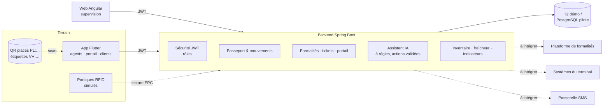

# Architecture — Dakar AutoTrack (prototype)

## Modèle de données
- `Vehicle` : VIN, code court `DAT-xxxxxx`, EPC RFID, BL, bénéficiaire, place, position confirmée, dates.
- `ParkingPlace` : `B-3-18`, QR `PL:B-3-18`, dernière lecture (date + source) → carte « fraîcheur ».
- `Inspection` : photos (8 vues), réserves, carburant, clés, kilométrage.
- `Formality` : BL, bon de livraison, paiement, **BAE**, bénéficiaire → disponibilité administrative.
- `Movement` : départ/arrivée scannés, agent, heure → trace complète ou « à régulariser ».
- `ReadEvent` : lectures QR / RFID / rafale → chaîne de garde, incohérences.
- `Ticket` : QR signé HMAC, validité, usage unique. `GatePassage` : décision au portail.
- `Alert`, `VerificationTask`, `AssistantAction` (proposée → confirmée/annulée), `PilotMeasure`.

## Statut calculé d'un véhicule
| Statut | Règle |
|---|---|
| `EXITED` | sortie validée au portail |
| `POSITION_TO_CONFIRM` | position jamais scannée ou déplacement sans scan d'arrivée |
| `READY` (« Prêt à enlever ») | localisé **et** toutes les formalités reçues |
| `AWAITING_AUTHORIZATION` | localisé, formalités incomplètes |

Étapes du tableau des enlèvements : formalités en cours → autorisé (ticket à émettre) → ticket émis → au portail → sorti.

## Principales routes de l'API
Voir Swagger UI (`/swagger-ui.html`) pour le détail.

| Méthode | Route | Rôles |
|---|---|---|
| POST | `/api/auth/login`, `/api/auth/refresh`, `/api/client/login` | public |
| GET | `/api/park`, `/api/park/incoherences`, `/api/park/suggest-place` | personnel |
| POST | `/api/park/sweep`, `/api/park/zone-read` | personnel |
| GET | `/api/vehicles`, `/api/vehicles/{vin}`, `/api/vehicles/counts` | personnel |
| POST | `/api/vehicles`, `/vin-check`, `/{vin}/park`, `/{vin}/move`, `/{vin}/photos` ; PUT `/{vin}/inspection` | agent, superviseur |
| POST | `/api/vehicles/{vin}/formalities/{type}/receive` | superviseur |
| POST | `/api/vehicles/{vin}/ticket` | agent, superviseur |
| GET | `/api/pickups/board`, `/api/movements…`, `/api/tasks` | personnel |
| POST | `/api/gate/scan`, `/api/gate/passages/{id}/decision` | portail, superviseur |
| GET | `/api/indicators` | superviseur |
| POST | `/api/assistant/chat`, `/api/assistant/actions/{id}` | personnel |
| GET/POST | `/api/client/me`, `/api/client/notify` | client |
